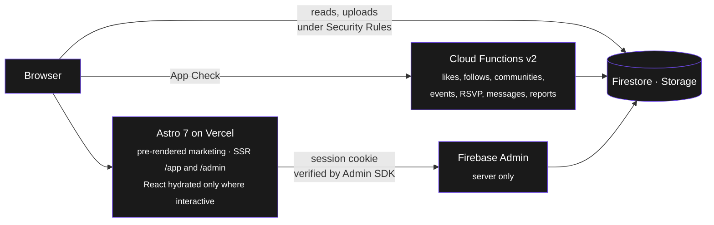

<div align="center">

# Ralli

**A social network built around communities and events.**

Posts start the conversation. Shared spaces and real-life meetups give it a future.

[](https://github.com/rito27959-arch/ralli-social/actions/workflows/ci.yml)


[**Architecture**](docs/ARCHITECTURE.md) &nbsp;·&nbsp; [**Deployment**](docs/DEPLOYMENT.md) &nbsp;·&nbsp; [**Roadmap**](docs/ROADMAP.md)

</div>

<br>

> [!NOTE]
> **Ralli is a working foundation, not a finished product.** Real social interactions work once a Firebase project is connected. No payment, ad, subscription, revenue figure or Firebase deployment is simulated. *Ralli* is a working name.

## What works today

<table>
<tr>
<td width="33%" valign="top">

**People**
- E-mail (verified) or Google sign-in
- Server-verified SSR sessions
- Name, bio and photo editing
- Follows

</td>
<td width="33%" valign="top">

**Conversation**
- Text posts with one image
- Comments and likes
- Real-time private text messages
- Post reporting with admin review

</td>
<td width="33%" valign="top">

**Together**
- Create and join public communities
- Events with transactional, capacity-aware RSVP
- A financial scenario simulator

</td>
</tr>
</table>

## Architecture



- **Identity** — a fresh Firebase ID token is exchanged for a session cookie verified by the Admin SDK on private routes, with Origin and CSRF-token checks on server operations.
- **Writes** — `posts` and `comments` are written directly under restrictive rules; every other mutation goes through validated, transactional Cloud Functions.
- **Privilege** — financial and administrative rights are unreachable from the client. Only the server can grant the `admin` claim.

Full data model, queries and known limits: [`docs/ARCHITECTURE.md`](docs/ARCHITECTURE.md).

## Get started

```bash
npm ci
npm --prefix functions ci
cp .env.example .env.local     # then fill in your Firebase project settings
npm run dev
```

Firebase web keys may be public; service accounts and secrets must **never** reach the browser.

## Verify

```bash
npm run check          # types
npm test               # unit tests
npm run test:rules     # Firestore and Storage security rules
npm run build
npm run test:e2e       # Playwright
```

## Before a public launch

Account deletion and export, private profiles and communities, advanced roles, invitations, notifications, blocking, complete moderation, age checks, a verified CSP, validated legal policies, structured logs and backups. Messages are **not** end-to-end encrypted — access relies on Firestore rules and server permissions. See [`docs/ROADMAP.md`](docs/ROADMAP.md) for the full list and the step-by-step plan to find first customers.

<br>

<div align="center">
<sub>Designed and built in Yaoundé, Cameroon.</sub>
</div>
